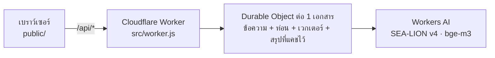

# อ่านทัน — ผู้ช่วยอ่านหนังสือด้วย AI

Mini-Project (งานเดี่ยว): เว็บแอปที่ประยุกต์ใช้ AI ช่วยนักเรียนนักศึกษาอ่านหนังสือก่อนสอบ

**ใช้งานจริง:** https://antan-study-ai.demo-agent-jum.workers.dev

วางเนื้อหาจากชีท สไลด์ หรือโน้ต (หรืออัปโหลด PDF / TXT) แล้ว AI จะ

1. **สรุป** — ภาพรวม ประเด็นสำคัญ และคำศัพท์ที่ควรรู้
2. **ออกข้อสอบ** — ปรนัย 4 ตัวเลือก 3 / 5 / 10 ข้อ เลือกระดับง่าย–ยาก ตรวจทันทีพร้อมเฉลยและเหตุผล
3. **ตอบคำถามจากเนื้อหา** — ตอบโดยอ้างอิงเฉพาะเนื้อหาที่ให้มา พร้อมเลขอ้างอิง [1] [2] กดแล้วไปไฮไลต์ข้อความต้นฉบับ

## แนวคิด AI ที่ใช้

| แนวคิด | ใช้ทำอะไรในแอป | ไฟล์ |
|---|---|---|
| **Large Language Model (LLM)** | สรุป ออกข้อสอบ และตอบคำถามเป็นภาษาไทย ด้วย SEA-LION v4 (27B) ที่ฝึกมาสำหรับภาษาในเอเชียตะวันออกเฉียงใต้ | `src/worker.js` |
| **Text Embedding** | แปลงเนื้อหาแต่ละท่อนและคำถามเป็นเวกเตอร์ 1024 มิติ ด้วย bge-m3 (รองรับหลายภาษารวมภาษาไทย) | `src/lib/engine.js` |
| **Semantic Search** | หาท่อนเนื้อหาที่ความหมายใกล้คำถามที่สุดด้วย cosine similarity ไม่ใช่แค่จับคำตรงกัน | `src/lib/retrieve.js` |
| **RAG (Retrieval-Augmented Generation)** | ส่งเฉพาะท่อนที่เกี่ยวข้องให้ LLM ตอบ บังคับให้ตอบจากเนื้อหาและอ้างอิงที่มา ลดการ “มั่ว” (hallucination) | `src/lib/engine.js` |
| **Prompt Engineering** | กำหนดบทบาท กติกา และให้ตอบเป็น JSON ตามโครงสร้างที่กำหนด | `src/lib/prompts.js` |
| **Map-Reduce Summarization** | เนื้อหายาวเกิน context: สรุปทีละส่วนพร้อมกัน แล้วสรุปรวมอีกรอบ | `src/lib/engine.js` |
| **Output Validation** | ตรวจ JSON ที่ AI ตอบ ตัดข้อสอบที่ผิดรูปแบบ (ตัวเลือกไม่ครบ/ซ้ำ/เฉลยผิดช่วง) และลองใหม่อัตโนมัติ | `src/lib/parse.js` |

### การถาม-ตอบทำงานอย่างไร (RAG)

```mermaid
flowchart LR
  subgraph ตอนเพิ่มเนื้อหา
    A[เนื้อหา] --> B[แบ่งเป็นท่อน ~700 ตัวอักษร<br/>ซ้อนกัน 120 ตัวอักษร]
    B --> C[bge-m3<br/>ท่อนละ 1 เวกเตอร์]
    C --> D[(SQLite ใน<br/>Durable Object)]
  end
  subgraph ตอนถาม
    Q[คำถาม] --> E[bge-m3<br/>เวกเตอร์คำถาม]
    E --> F[cosine similarity<br/>เลือก 4 ท่อนที่ใกล้สุด]
    D --> F
    F --> G["SEA-LION<br/>ตอบจากท่อนที่ให้ + อ้างอิงเลขที่มา"]
    G --> H[คำตอบ + ที่มา]
  end
```

### เลือกโมเดลอย่างไร

ทดสอบกับเนื้อหาชีววิทยาภาษาไทยชุดเดียวกัน (Workers AI, พฤศจิกายน 2569)

| โมเดล | สรุป | ออกข้อสอบ | JSON ถูกรูปแบบ | ภาษาไทย |
|---|---|---|---|---|
| **SEA-LION v4 27B** ✓ | 4.3 วิ | 6.9 วิ | ✓ | เป็นธรรมชาติ |
| Gemma 4 26B | 9.1 วิ | 27.6 วิ | ✗ | ดี |
| Qwen 3.8 27B | 19.6 วิ | 23.5 วิ | ✓ | ดี |
| gpt-oss-120b | 7.6 วิ | 24.4 วิ | ✓ | ดี ปนสัญลักษณ์อังกฤษ |

SEA-LION เร็วที่สุด ภาษาไทยเป็นธรรมชาติ และตอบ JSON ถูกต้อง จึงใช้เป็นโมเดลหลัก

## สถาปัตยกรรม



- **หน้าเว็บ** HTML/CSS/JS ล้วน ไม่มีเฟรมเวิร์ก อ่าน PDF ในเบราว์เซอร์ด้วย pdf.js
- **Backend** Cloudflare Worker + Durable Object (SQLite) เอกสารละ 1 ตัว ลบตัวเองอัตโนมัติเมื่อครบ 30 วัน
- **ตรรกะหลัก** อยู่ใน `src/lib/` แยกจาก Cloudflare ทั้งหมด จึงเทสบน Node ได้ด้วย AI ปลอม

```
src/
  worker.js        Worker + Durable Object + ตัวเรียก Workers AI
  lib/engine.js    รับเนื้อหา สรุป ออกข้อสอบ ถาม-ตอบ
  lib/chunk.js     แบ่งเนื้อหาเป็นท่อน (รองรับภาษาไทยที่ไม่เว้นวรรค)
  lib/retrieve.js  cosine similarity และเลือกท่อนที่เกี่ยวข้อง
  lib/prompts.js   prompt ทั้งหมด
  lib/parse.js     ตรวจและทำความสะอาดคำตอบของ AI
  lib/http.js      เส้นทาง /api/*
public/            หน้าเว็บ
test/              เทส 26 ข้อ (node:test)
```

## API

| Method | Path | ทำอะไร |
|---|---|---|
| POST | `/api/docs` | เพิ่มเนื้อหา `{ title, text }` → แบ่งท่อน + ทำ embedding |
| GET | `/api/docs/:id` | ข้อมูลเอกสารและข้อความต้นฉบับ |
| POST | `/api/docs/:id/summary` | สรุป `{ refresh? }` (แคชไว้ เรียกซ้ำไม่เสียโควตา) |
| POST | `/api/docs/:id/quiz` | ออกข้อสอบ `{ count: 3|5|10, level: easy|medium|hard }` |
| POST | `/api/docs/:id/ask` | ถาม `{ question, history? }` → `{ answer, sources }` |
| DELETE | `/api/docs/:id` | ลบเอกสาร |

## รันบนเครื่อง

ต้องมี Node.js 20+ และบัญชี Cloudflare (ใช้แพ็กเกจฟรีได้)

```bash
npm install
npm test               # เทส 26 ข้อ ไม่ต้องต่อเน็ต ไม่เสียโควตา AI
npx wrangler login     # ครั้งแรกครั้งเดียว
npm run dev            # http://localhost:8787 (เรียก Workers AI ตัวจริง)
npm run deploy         # ขึ้น Cloudflare
```

## ข้อจำกัด

- เนื้อหาไม่เกิน 60,000 ตัวอักษรต่อเอกสาร PDF ต้องเป็นไฟล์ที่คัดลอกข้อความได้ (ไม่รองรับภาพสแกน)
- ใช้โควตาฟรีของ Workers AI ต่อวัน ถ้าครบ แอปจะแจ้งให้ลองใหม่วันถัดไป
- ไม่มีระบบล็อกอิน ใครมีลิงก์เอกสาร (รหัสสุ่ม UUID) ก็เปิดได้ ห้ามใส่ข้อมูลส่วนตัว
- AI อาจผิดพลาด ควรตรวจกับเนื้อหาจริงทุกครั้ง แอปจึงแสดงที่มาของทุกคำตอบ
